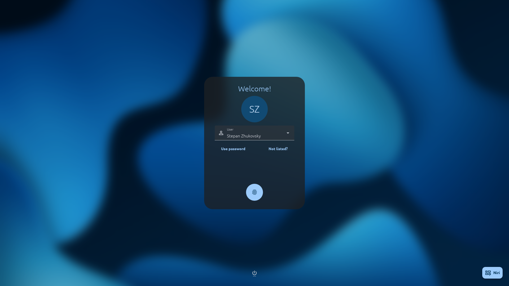

# Fingerprint login



Use your fingerprint to sign in, with password entry available when you need it.
Authentication is performed by greetd using the system's PAM configuration.

## Before you start

Your system needs a supported reader, fprintd and its PAM integration, and a
finger enrolled for your account. Enroll a finger using your desktop's settings
or `fprintd-enroll`.

Enable fingerprint authentication in the PAM stack used by greetd, preserving
password authentication as a fallback. Configure a finite scan limit and timeout,
for example two scans with a ten-second timeout per attempt. See the setup notes
for [standard Linux distributions](greetd/standard.md#fingerprint-login) or
[NixOS](greetd/nixos.md#fingerprint-login).

## Enable fingerprint login

Add this to your mdgreet configuration, usually `/etc/greetd/mdgreet.toml`:

```toml
[auth.fingerprint]
enable = true
auto_start = true
```

If you launch mdgreet with `--config`, edit that file instead. `enable` defaults
to `false`; `auto_start` defaults to `true`. Set `auto_start = false` if you want
to start with the fingerprint button. See the
[authentication reference](config/authentication.md) for all options and their behaviour.

## Sign in

mdgreet starts on the clock screen with either sign-in method. Press any key or
click to open the card. When fingerprint login is enabled, opening the card
starts authentication for the selected user when `auto_start = true`. With
`auto_start = false`, press the fingerprint button first. Then touch the reader
with an enrolled finger.

During an active attempt, pressing the fingerprint button shows an inline hint.
Scan errors appear automatically when PAM reports them. Pressing the button
during an active attempt does not restart scanning or reset its limit.

When the system finishes the fingerprint stage without authenticating you, the
password card opens automatically. You can also select **Use password** at any
time to open it yourself. The links sit directly below the inputs, with
**Not listed?** on the right. The main sign-in button stays in the same position.

## Enter a password

The password field receives focus immediately. You can type and press **Enter**
or the sign-in button while PAM is still waiting for a fingerprint. mdgreet keeps
that response in memory and sends it once, only when PAM requests a password.
The field is cleared after submission, and another submission is disabled until
the current response has been processed. For a manual username, confirm the name
with **Enter** before entering the password. Confirming a manually entered
username starts authentication, including when `auto_start = false`.

**Use password does not interrupt an active fingerprint check.** Standard greetd
runs the methods sequentially, so password verification can wait for the scan
limit or timeout. You do not have to touch the reader to continue. A successful
fingerprint can still sign you in while that check is active.

When PAM rejects a password, the field is highlighted in red with an inline
error. Editing clears the error, and focus returns to the field. A retry starts a fresh PAM conversation;
if your stack starts with fingerprint, its finite waiting period applies again.
A correct password completes login without requiring a fingerprint.

Press **Esc** to return to the clock. Leaving the card or changing users cancels
the previous attempt in the background. Cleanup may wait for the active PAM
module to respond; new conversations wait for that cleanup so they do not overlap.

## Attempt limits

Scan attempts, timeouts, password retry delays and account lockout are owned by
your system's PAM policy. mdgreet does not restart scans automatically after a
failed conversation and does not infer a fingerprint counter from localized
messages. The interface therefore shows PAM feedback rather than a scan counter.

With `max-tries=2 timeout=10`, two unmatched scans end the fingerprint stage. If
you do not touch the reader, the first attempt times out after about ten seconds.
A failed scan starts a new timeout for the next attempt, so two attempts can
consume close to twenty seconds of scan time, plus device setup and processing.
After fallback, the same conversation accepts a password; a new login attempt
may start fingerprint checks again.

A finite fingerprint timeout is different from an account lockout after repeated
password failures. mdgreet keeps the interface responsive during system delays;
it does not replace the system's protection with a UI-only timer.

## Troubleshooting

- **No fingerprint waiting:** check both the mdgreet setting and the actual PAM
  stack used by greetd. Working sudo or screen unlock is not sufficient proof.
- **Password waits indefinitely:** check the fingerprint rule's finite `timeout`
  and `max-tries`, including rules reached through `include` or `substack`.
- **Another scan starts after password entry:** check for duplicate fingerprint
  rules in the effective PAM stack. A password retry may also start a new stack.
- **Reader unavailable:** PAM should continue to its password fallback. Check the
  fprintd service and PAM control flags if that fallback does not occur.
- **Login succeeds without touching the reader at the card:** on devices that
  capture a fingerprint when you press the power button, authentication may use
  that earlier capture. For diagnosis, power on with an unenrolled finger and
  avoid the reader until the card opens. Explicit start changes the request time,
  not the reader's capture policy.
